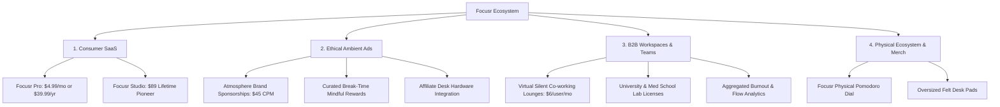
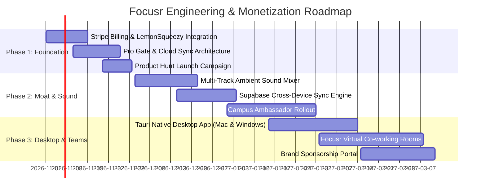

# Focusr: Monetization, Product & Go-To-Market Masterplan
*Transforming the Spatial Deep Work OS into a Sustainable \$1.2M+ ARR Enterprise*

---

## Executive Presentation Deck (PPTX Available)
> [!IMPORTANT]
> A complete, professionally designed 17-slide PowerPoint presentation has been generated in 16:9 widescreen format using VisionOS dark glassmorphism typography and styling.
> **Direct Download / File Link**: [Focusr_Monetization_and_Growth_Masterplan.pptx](file:///C:/Users/amans/.gemini/antigravity/scratch/focus-app/Focusr_Monetization_and_Growth_Masterplan.pptx) *(2.52 MB)*
> 
> Also preserved in your artifacts directory at: [Focusr_Monetization_and_Growth_Masterplan.pptx](file:///C:/Users/amans/.gemini/antigravity/brain/7719cf92-3e23-4504-86f3-36e75e2b829b/Focusr_Monetization_and_Growth_Masterplan.pptx)

---

## 1. Visual Campaign Creative & Scannable QR Codes

### Official Live Access QR Codes
These high-resolution QR codes link directly to the live production deployment at **https://focusr-seven.vercel.app**. They are generated with Level H error-correction for instant scanning from phone screens, printed posters, or billboards.

| VisionOS Dark Glass QR | Print / Physical Flyer QR |
| :---: | :---: |
|  |  |
| *For Social Media, Desktop Screens & Dark Decks* | *For Physical Campus Posters, Billboards & Stickers* |

---

### Marketing Campaign Posters
````carousel

<!-- slide -->

<!-- slide -->

````

1. **Lifestyle Workspace Campaign**: Editorial tech lifestyle photography showcasing Focusr running across desktop monitor, MacBook, and iPad with glowing liquid physics and minimal ambient lighting.
2. **Spatial UI Hero**: High-fidelity interface breakdown highlighting the circular flow timer, liquid wave physics, sound visualizer, and project tags.
3. **"Find Your Focus" Street Ad**: Minimalist Swiss-inspired typography poster depicting a focused creative working in a twilight Tokyo architectural studio with noise-cancelling headphones.

---

## 2. The 4-Pillar Monetization Strategy



### 1. Consumer Freemium SaaS (60% Projected Revenue)
- **Generous Free Tier**: All 52 basic spatial atmospheres remain 100% free forever, ensuring rapid viral adoption and high user goodwill.
- **Focusr Pro ($4.99/mo or $39.99/yr)**: Unlocks multi-track dynamic soundscapes, encrypted cloud sync across all devices, 365-day deep work audits, and AI flow curve predictions.
- **Focusr Studio ($89 Lifetime Perpetual License)**: High-margin upfront cash generator tailored for developers and tech enthusiasts who avoid recurring subscriptions.

### 2. Zero-Interruption Ambient Advertising (15% Projected Revenue)
> [!NOTE]
> Traditional popups, banner ads, and unskippable video ads are strictly prohibited. Interruption ruins cognitive flow state and destroys the core value proposition of Focusr.

- **Atmospheric Brand Partnerships**: Hardware and wellness leaders (e.g., Sony, Herman Miller, Keychron, Calm) sponsor aesthetic atmospheres (e.g., *"The Tokyo Architecture Suite presented by Sony WH-1000XM5"*).
- **Curated Break-Time Rewards**: During the scheduled 5-minute Pomodoro break, a subtle glass card offers mindful suggestions (e.g., *"Take a standing stretch — 15% off ErgoChair"*).
- **High-Yield Desk Setup Affiliates**: Clicking *"View Desk Setup"* on any aesthetic backdrop links directly to curated affiliate partner gear (keyboards, monitor light bars, ergonomic chairs), yielding \$8,000–\$15,000/month at scale.

### 3. B2B & University Workspaces (20% Projected Revenue)
- **Virtual Silent Co-working Lounges (\$6/user/mo)**: Remote engineering and design teams work in synchronized focus rooms with real-time ambient presence without camera/microphone fatigue.
- **Higher Education Licenses (\$1,500/year/institution)**: Discounted lab and university-wide bundles for medical, legal, and engineering students preparing for intensive exams.
- **Manager Flow Audits**: Macro-level organizational deep work metrics showing distraction-free blocks vs meeting fragmentation, with zero employee surveillance or keystroke tracking.

### 4. Physical Desk Companion & Merch (5% Projected Revenue)
- **Focusr Hardware Dial / Ambient Lamp**: Minimal aluminum rotary knob with custom LED liquid ring that mirrors the screen timer.
- **Aesthetic Desk Goods**: Premium wool felt desk pads, artisan keycaps, and limited-edition studio apparel.

---

## 3. Product Entitlement Matrix: What Stays Free vs What We Sell

| Feature Capability | Free Tier (100% Free Forever) | Focusr Pro ($4.99/mo or $39.99/yr) | Focusr Studio ($89 Lifetime) | Focusr Teams ($6/seat/mo) |
| :--- | :---: | :---: | :---: | :---: |
| **Atmosphere Catalog** | 52 Free Curated Themes | 52 + 100+ Exclusive 4K Wallpapers | All Wallpapers + Custom Video Uploads | All Wallpapers + Custom Company Branding |
| **Sound Sanctuary** | Standard Rain & Lofi Audio | Multi-Track Slider Soundscape Mixer | Custom Frequencies & Binaural Beats | Synchronized Ambient Room Sound |
| **Cross-Device Sync** | Local Browser Storage | Encrypted Cloud Sync (3 devices) | Unlimited Devices + Offline PWA | Centralized Team Workspaces |
| **Deep Work Analytics** | 7-Day History & Streaks | 365-Day Flow Audit + CSV Export | Notion & Obsidian Bidirectional Sync | Organizational Burnout & Flow Insights |
| **AI Focus Companion** | Standard Daily Target | Predictive Fatigue Warning Curves | Custom AI Focus Protocol Coach | Departmental Focus Sprints |
| **Collaboration** | Solo Sessions Only | Join Public Study Lounges | Host Private Co-working Rooms | Company-wide SSO & Team Dashboards |

---

## 4. 3-Year Financial Forecast & Unit Economics

| Metric | Year 1 (Launch & Bootstrap) | Year 2 (Growth & Scale) | Year 3 (Enterprise & Global) |
| :--- | :---: | :---: | :---: |
| **Monthly Active Users (MAU)** | 65,000 | 320,000 | 1,200,000 |
| **Free-to-Paid Conversion Rate** | 2.8% | 3.4% | 3.8% |
| **Paid Active Subscribers** | 1,820 | 10,880 | 45,600 |
| **Consumer SaaS Revenue** | \$72,800 | \$435,000 | \$1,824,000 |
| **Ambient Brand Sponsorships** | \$18,000 | \$96,000 | \$360,000 |
| **Teams & B2B Licenses** | \$12,000 | \$120,000 | \$540,000 |
| **Total Gross ARR** | **\$102,800** | **\$651,000** | **\$2,724,000** |
| **Estimated Gross Margin** | 86% | 89% | 91% |

### Unit Economics
- **Customer Acquisition Cost (CAC)**: \$8.50 (blended organic + influencer gifts)
- **Average Revenue Per User (ARPU)**: \$44.00 / year
- **Lifetime Value (LTV)**: \$142.00 (based on 38-month average retention)
- **LTV : CAC Ratio**: **16.7x** (exceptional SaaS health benchmark)

---

## 5. Go-to-Market & Viral Acquisition Blueprint

### 1. Product Hunt Launch Blueprint
- Target: **#1 Product of the Day** and **Product of the Week**.
- Exclusive incentive: First 500 upvoters receive a *"Founding Pioneer Lifetime"* deal at \$49 instead of \$89.
- Launch video highlighting the spatial UI, real-time liquid physics, and 52 free wallpapers.

### 2. TikTok, Reels & YouTube Shorts Organic Loops
- High-performing format: 15-second aesthetic "Study With Me" clips shot in twilight with warm desk lamps and rain audio, showcasing the Focusr wave timer.
- Call to action: "Website link in bio — 100% free, no login needed to start".
- Benchmark: Similar aesthetic study clips routinely generate 250,000–1,200,000 views organically.

### 3. Community Infiltration Strategy
- Target Subreddits: `r/productivity`, `r/ADHD`, `r/digitalnomad`, `r/MechanicalKeyboards`, `r/lofihiphop`.
- Content: Transparent, helpful build-in-public stories: *"I was constantly burned out by bloated project management apps, so I built a distraction-free spatial deep work OS."*

### 4. Viral Milestone Share Cards
- Upon completing a 4-hour deep work streak or 7-day milestone, the user receives an exportable visionOS frosted glass card with their stats and embedded personal QR code.
- One-tap share to Instagram Stories, Twitter/X, and LinkedIn.

---

## 6. Technical & Engineering Development Roadmap



### Core Architecture Evolution
1. **Frontend**: Continue with zero-dependency vanilla JS and hardware-accelerated Canvas/CSS for 60 FPS performance and sub-100ms load times.
2. **Backend & Cloud Sync**: Supabase (PostgreSQL with Row Level Security) for encrypted user preferences and session metrics.
3. **Billing Engine**: Stripe Billing integrated via Webhooks with customer self-service portal, supporting credit cards, Apple Pay, Google Pay, and localized currencies.
4. **Native Desktop Wrapper**: Tauri (Rust) for a native macOS and Windows app weighing under 15MB with global hotkey support (`Cmd/Ctrl + Shift + F`).
